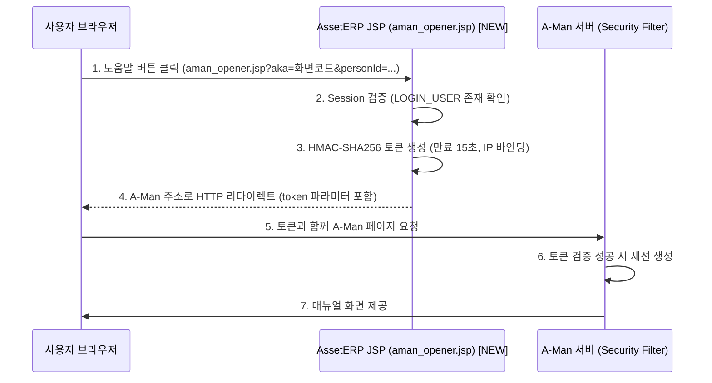

# 신규 연동 파일(aman_opener.jsp) 도입 및 배포 계획 (aman_opener_plan.md)

이 문서는 기존 `user_manual.jsp`를 수정하는 대신, 신규 연동 파일인 **`aman_opener.jsp`**를 신규로 생성하여 AssetERP와 A-Man 간의 보안 연동을 처리하는 방안에 대한 설계 및 계획입니다.

---

## 1. Goal Description (목표 및 배경)
기존 `user_manual.jsp`는 내부적으로 GWT/jstree 기반의 레거시 도움말 트리 뷰어 로직을 포함하고 있습니다.
* **문제점**: 이 파일을 직접 덮어쓰거나 수정할 경우, 혹시 모를 레거시 의존성이나 다른 시스템에서의 레거시 도움말 호출 시 사이드 이펙트(동작 불능 등)가 발생할 위험이 있습니다.
* **해결책**: 레거시 파일은 그대로 두고, 오직 A-Man 연동(토큰 생성 및 리다이렉트)만을 담당하는 전용 파일인 **`aman_opener.jsp`**를 새로 생성하여 AssetERP webapps 루트 경로에 배포합니다.
* **장점**:
  1. **위험 최소화**: 기존 파일(`user_manual.jsp`)을 전혀 건드리지 않으므로 기존 시스템에 미치는 영향이 0%입니다.
  2. **유지보수 용이**: GWT/jstree 등 불필요한 레거시 코드가 없어 코드의 크기가 매우 작고 가볍습니다.
  3. **명확한 역할 분담**: 파일명(`aman_opener.jsp`)만으로도 A-Man 도움말 시스템을 열어주는 게이트웨이 역할을 함을 명확히 알 수 있습니다.

---

## 2. 설계 및 흐름도



---

## 3. Proposed Changes (변경 사항)

### [Component: AssetERP JSP]
#### [NEW] `aman_opener.jsp`
* **위치**: AssetERP의 webapps 경로 (예: `webapps/ROOT/aman_opener.jsp` 또는 GWT 앱 경로)
* **내용**: 
  - 세션을 체크하여 로그인 여부를 확인합니다.
  - HMAC-SHA256 대칭키 알고리즘을 사용해 일회성 토큰을 생성합니다.
  - A-Man 서버의 URL로 리다이렉션합니다.

```jsp
<%@ page language="java" contentType="text/html; charset=UTF-8" pageEncoding="UTF-8"%>
<%@ page import="javax.crypto.Mac" %>
<%@ page import="javax.crypto.spec.SecretKeySpec" %>
<%@ page import="java.nio.charset.StandardCharsets" %>
<%@ page import="java.util.Base64" %>
<%
    // 0. A-Man 서비스 루트 URL 설정 (상단 상수로 선언)
    final String AMAN_BASE_URL = "https://aview.k-fs.co.kr:7171/aman";

    // 브라우저 리다이렉션 캐싱 방지 설정
    response.setHeader("Cache-Control", "no-cache, no-store, must-revalidate"); // HTTP 1.1
    response.setHeader("Pragma", "no-cache"); // HTTP 1.0
    response.setDateHeader("Expires", 0); // Proxies

    // 1. AssetERP 세션 및 로그인 유저 인증 여부 검증
    HttpSession erpSession = request.getSession(false);
    boolean isAuthorized = (erpSession != null && erpSession.getAttribute("LOGIN_USER") != null);

    if (!isAuthorized) {
        response.setContentType("text/html; charset=UTF-8");
        out.println("<html><body style='text-align:center; padding-top:100px; font-family:sans-serif; color:#64748b;'>");
        out.println("<h2>⚠️ 접근 권한이 없습니다.</h2>");
        out.println("<p>AssetERP 시스템에 로그인한 후 이용해 주십시오.</p>");
        out.println("</body></html>");
        return;
    }

    // 2. 화면 식별 파라미터(aka) 및 사용자 식별자 획득
    String aka = request.getParameter("aka");
    String userId = request.getParameter("personId");
    if (userId == null || userId.trim().isEmpty()) {
        userId = "unknown";
    }
    
    // 3. HMAC-SHA256 보안 토큰 생성
    String secretKey = "A-Man-Shared-Secret-Key-Custom-Value-Here!"; // A-Man 서버와 일치시켜야 함
    String clientIp = request.getRemoteAddr();
    long timestamp = System.currentTimeMillis();
    
    // 페이로드 데이터 조립 (사용자 ID | 타임스탬프 | 요청자 IP)
    String payload = userId + "|" + timestamp + "|" + clientIp;
    
    // HMAC-SHA256 서명 계산
    Mac sha256_HMAC = Mac.getInstance("HmacSHA256");
    SecretKeySpec secretKeySpec = new SecretKeySpec(secretKey.getBytes(StandardCharsets.UTF_8), "HmacSHA256");
    sha256_HMAC.init(secretKeySpec);
    byte[] hashBytes = sha256_HMAC.doFinal(payload.getBytes(StandardCharsets.UTF_8));
    String signature = Base64.getUrlEncoder().withoutPadding().encodeToString(hashBytes);
    
    // 최종 토큰 (페이로드 + 서명)을 Base64 인코딩
    String rawToken = payload + "|" + signature;
    String secureToken = Base64.getUrlEncoder().withoutPadding().encodeToString(rawToken.getBytes(StandardCharsets.UTF_8));

    // 4. 리다이렉트 주소 계산
    String redirectUrl;
    if (aka != null && !aka.trim().isEmpty()) {
        // [화면별 도움말] 요청인 경우
        redirectUrl = AMAN_BASE_URL + "/manual/" + aka + "?token=" + secureToken;
    } else {
        // [전체 매뉴얼] 요청인 경우
        redirectUrl = AMAN_BASE_URL + "/docs?token=" + secureToken;
    }
    
    response.sendRedirect(redirectUrl);
%>
```

### [Component: Database (sys06_menu)]
#### `sys06_menu` 테이블 URL 컬럼 업데이트 SQL 템플릿
* **기존**: `sys06_menual_url` 컬럼에 직접 html 경로 또는 `user_manual.jsp?aka=xxx` 등이 들어가 있음
* **변경**: 신규 배포한 `aman_opener.jsp`를 가리키도록 설정
```sql
-- 예시: 자산등록 화면 도움말 경로를 신규 opener JSP로 업데이트
UPDATE sys06_menu 
   SET sys06_menual_url = 'aman_opener.jsp?aka=asset_register'
 WHERE sys06_class_nm = 'Ast01_AssetRegister';
```

---

## 4. Verification Plan (확인 계획)

### Manual Verification (수동 확인 절차)
1. **`aman_opener.jsp` 서버 업로드**: AssetERP 개발/테스트 서버의 webapps 경로에 `aman_opener.jsp` 파일 배치.
2. **테스트 쿼리 실행**: 특정 테스트 메뉴의 도움말 주소를 `aman_opener.jsp?aka=테스트코드`로 업데이트.
3. **ERP 로그인 상태에서 클릭**: 정상적으로 일회성 토큰이 생성되고, A-Man 페이지로 리다이렉트되어 인증 통과 후 매뉴얼이 열리는지 확인.
4. **비로그인 상태에서 직접 주소 호출**: `http://erp-server/aman_opener.jsp` 직접 접근 시 권한 부족 경고창이 나타나는지 검증.
