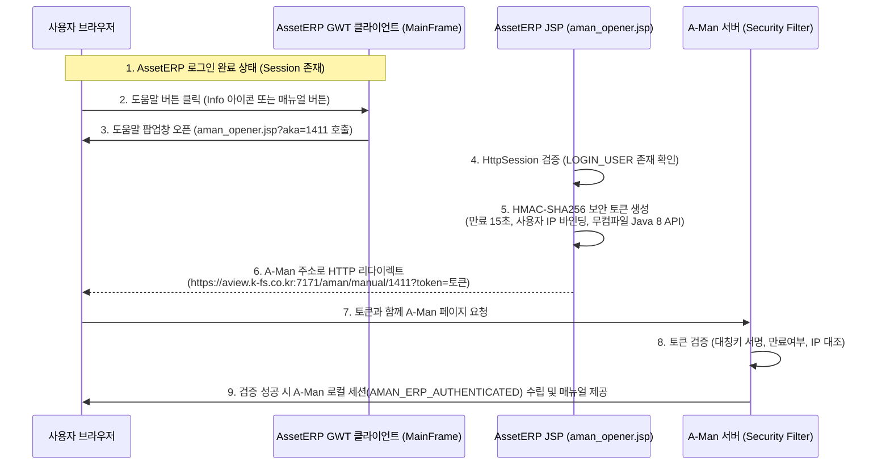

# AssetERP - A-Man 보안 강화 연동 종합 가이드 (보안강화-네트워크.md)

물리적으로 서버가 분리되어 있고 도메인이 달라 브라우저 쿠키가 자동 공유되지 않는 환경에서, **AssetERP의 컴파일 및 서버 재배포를 없애고(Zero-Compile)** A-Man(도움말 시스템)의 보안을 강화하는 통합 연동 연동 방안(방안 A-2 고도화 최종안)입니다.

기존 레거시 도움말 파일(`user_manual.jsp`)과의 충돌 및 부작용을 원천 차단하기 위해, 신규 게이트웨이인 **`aman_opener.jsp`**를 통해 단일 로그인(SSO) 및 보안 토큰 인증을 수행합니다.

---

## 목차
1. [연동 아키텍처 및 흐름도](#1-연동-아키텍처-및-흐름도)
2. [핵심 설계 원칙 및 아키텍처 결정 배경](#2-핵심-설계-원칙-및-아키텍처-결정-배경)
   * 2.1 [Zero-Compile (무컴파일) 준수](#21-zero-compile-무컴파일-준수)
   * 2.2 [배치 위치 선정 이유 (AssetERP Context)](#22-배치-위치-선정-이유-asseterp-context)
   * 2.3 [토큰 생성 주체 비교 (클라이언트 vs 서버)](#23-토큰-생성-주체-비교-클라이언트-vs-서버)
3. [AssetERP 영역 구현 (JSP & DB)](#3-asseterp-영역-구현-jsp--db)
   * 3.1 [aman_opener.jsp (최종 연동 게이트웨이)](#31-aman_openerjsp-최종-연동-게이트웨이)
   * 3.2 [sys06_menu 테이블 업데이트 SQL 규격](#32-sys06_menu-테이블-업데이트-sql-규격)
4. [A-Man 영역 구현 (Spring Boot Backend)](#4-a-man-영역-구현-spring-boot-backend)
   * 4.1 [ErpTokenValidationFilter.java (토큰 & IP 검증 필터)](#41-erptokenvalidationfilterjava-토큰--ip-검증-필터)
   * 4.2 [SecurityConfig.java (필터 등록 및 CORS 설정)](#42-securityconfigjava-필터-등록-및-cors-설정)
5. [세션 관리 및 보안 정책](#5-세션-관리-및-보안-정책)
   * 5.1 [AMAN_ERP_AUTHENTICATED 속성 생명주기](#51-aman_erp_authenticated-속성-생명주기)
   * 5.2 [사외망 직접 접근 제한 및 세션 만료 경고 (/aman/expired)](#52-사외망-직접-접근-제한-및-세션-만료-경고-amanexpired)
   * 5.3 [사내 IP 대역 프리패스 설정 예외 처리](#53-사내-ip-대역-프리패스-설정-예외-처리)
6. [배포 및 테스트 시나리오](#6-배포-및-테스트-시나리오)
   * 6.1 [개발 및 테스트 환경 정보](#61-개발-및-테스트-환경-정보)
   * 6.2 [시나리오별 검증 체크리스트](#62-시나리오별-검증-체크리스트)

---

## 1. 연동 아키텍처 및 흐름도



---

## 2. 핵심 설계 원칙 및 아키텍처 결정 배경

A-Man 도움말 시스템의 원활한 운영 및 최고 수준의 보안 통제를 보장하기 위해 아래 3가지 설계 원칙을 준수하여 개발하였습니다.

### 2.1 Zero-Compile (무컴파일) 준수
AssetERP의 GWT 클라이언트(`MainFrame.java`) 등 Java 백엔드 클래스 파일들을 수정하여 연동할 경우, 운영/배포 시마다 매번 WAS를 빌드하고 컴파일하는 큰 비용과 장애 리스크가 동반됩니다. JSP 파일은 수정 즉시 Tomcat WAS에 의해 동적 컴파일되므로, 연동 게이트웨이를 JSP 단일 파일(`aman_opener.jsp`)로 구현하여 **AssetERP의 소스코드 빌드 및 서버 배포 공수를 0%로 최소화**했습니다.

### 2.2 배치 위치 선정 이유 (AssetERP Context)
연동 게이트웨이인 `aman_opener.jsp`는 A-Man 서버가 아닌 **AssetERP 서버의 webapps 경로에 반드시 위치해야 합니다.** 
물리적/논리적으로 서로 격리된 두 WAS 간에는 브라우저 보안 정책 상 세션 쿠키(`JSESSIONID`)가 공유되지 않습니다. 따라서 사용자의 ERP 로그인 여부(`LOGIN_USER` 세션 속성)를 직접 조회하고 검증하기 위해서는 **세션을 직접 소유하고 있는 AssetERP 톰캣 컨텍스트 내에서 실행**되어야만 합니다.

### 2.3 토큰 생성 주체 비교 (클라이언트 vs 서버)
GWT 클라이언트(`MainFrame`) 단에서 직접 파라미터 조합 및 암호화 토큰을 생성해 A-Man으로 전송하는 구조는 심각한 보안 결함이 존재합니다:
* **비밀키 노출 위험**: 암호화 서명을 생성하기 위한 대칭키(`secretKey`)가 프론트엔드 자바스크립트 소스코드에 포함되어 브라우저 F12 개발자 도구 등을 통해 외부로 즉시 노출됩니다.
* **해결**: 보안 토큰 생성 연산은 오직 외부에서 접근 불가능한 **서버 내부(`aman_opener.jsp`)에서 안전하게 수행**한 뒤 리다이렉트 방식으로 클라이언트에 전달되도록 설계했습니다.

---

## 3. AssetERP 영역 구현 (JSP & DB)

### 3.1 aman_opener.jsp (최종 연동 게이트웨이)
AssetERP 서버의 webapps 루트 경로(예: `/webapps/ROOT/`)에 배치하여 사용합니다.

```jsp
<%@ page language="java" contentType="text/html; charset=UTF-8" pageEncoding="UTF-8"%>
<%@ page import="javax.crypto.Mac" %>
<%@ page import="javax.crypto.spec.SecretKeySpec" %>
<%@ page import="java.nio.charset.StandardCharsets" %>
<%@ page import="java.util.Base64" %>
<%
    // 0. A-Man 서비스 루트 URL 설정 (상단 상수로 선언)
    final String AMAN_BASE_URL = "https://aview.k-fs.co.kr:7171/aman";

    // 브라우저 리다이렉션 캐싱 방지 설정 (중요: 연속 클릭 시 캐시 오동작 방지)
    response.setHeader("Cache-Control", "no-cache, no-store, must-revalidate"); // HTTP 1.1
    response.setHeader("Pragma", "no-cache"); // HTTP 1.0
    response.setDateHeader("Expires", 0); // Proxies

    // 1. AssetERP 세션 및 로그인 유저 인증 여부 검증
    HttpSession erpSession = request.getSession(false);
    boolean isAuthorized = (erpSession != null && erpSession.getAttribute("LOGIN_USER") != null);

    if (!isAuthorized) {
        response.setContentType("text/html; charset=UTF-8");
        out.println("<html><body style='text-align:center; padding-top:100px; font-family:sans-serif; color:#64748b;'>");
        out.println("<h2>⚠️ 접근 권한이 없습니다.</h2>");
        out.println("<p>AssetERP 시스템에 로그인한 후 이용해 주십시오.</p>");
        out.println("</body></html>");
        return;
    }

    // 2. 화면 식별 파라미터(aka) 및 사용자 식별자 획득
    String aka = request.getParameter("aka");
    String userId = request.getParameter("personId");
    if (userId == null || userId.trim().isEmpty()) {
        userId = "unknown";
    }
    
    // 3. HMAC-SHA256 보안 토큰 생성
    String secretKey = "A-Man-Shared-Secret-Key-Custom-Value-Here!"; // A-Man 서버와 일치해야 함
    String clientIp = request.getRemoteAddr();
    long timestamp = System.currentTimeMillis();
    
    // 페이로드 데이터 조립 (사용자 ID | 타임스탬프 | 요청자 IP)
    // 주의: IPv6 주소의 콜론(:) 문자 충돌을 막기 위해 구분자로 파이프(|) 문자를 사용해야 합니다.
    String payload = userId + "|" + timestamp + "|" + clientIp;
    
    // HMAC-SHA256 서명 계산
    Mac sha256_HMAC = Mac.getInstance("HmacSHA256");
    SecretKeySpec secretKeySpec = new SecretKeySpec(secretKey.getBytes(StandardCharsets.UTF_8), "HmacSHA256");
    sha256_HMAC.init(secretKeySpec);
    byte[] hashBytes = sha256_HMAC.doFinal(payload.getBytes(StandardCharsets.UTF_8));
    String signature = Base64.getUrlEncoder().withoutPadding().encodeToString(hashBytes);
    
    // 최종 토큰 (페이로드 + 서명)을 Base64 인코딩
    String rawToken = payload + "|" + signature;
    String secureToken = Base64.getUrlEncoder().withoutPadding().encodeToString(rawToken.getBytes(StandardCharsets.UTF_8));

    // 4. 리다이렉트 주소 계산
    String redirectUrl;
    if (aka != null && !aka.trim().isEmpty()) {
        // [화면별 도움말] 요청인 경우
        redirectUrl = AMAN_BASE_URL + "/manual/" + aka + "?token=" + secureToken;
    } else {
        // [전체 매뉴얼] 요청인 경우
        redirectUrl = AMAN_BASE_URL + "/docs?token=" + secureToken;
    }
    
    response.sendRedirect(redirectUrl);
%>
```

### 3.2 sys06_menu 테이블 업데이트 SQL 규격
GWT 클라이언트는 화면별 도움말 주소를 DB에서 참조하므로, 도움말 링크를 신규 게이트웨이 경로로 일괄 또는 개별 업데이트합니다.

```sql
-- [예시] 자산등록 화면(Ast01_AssetRegister)의 도움말 경로를 신규 게이트웨이로 변경
UPDATE sys06_menu 
   SET sys06_menual_url = 'aman_opener.jsp?aka=asset_register'
 WHERE sys06_class_nm = 'Ast01_AssetRegister';
```

---

## 4. A-Man 영역 구현 (Spring Boot Backend)

### 4.1 ErpTokenValidationFilter.java (토큰 & IP 검증 필터)
넘어온 일회성 토큰(`token`)을 검증하고, 성공 시 A-Man 전용 로컬 세션을 수립하는 스프링 시큐리티 필터입니다.

```java
package kr.co.kfs.aman.security;

import org.springframework.web.filter.OncePerRequestFilter;
import javax.servlet.FilterChain;
import javax.servlet.ServletException;
import javax.servlet.http.HttpServletRequest;
import javax.servlet.http.HttpServletResponse;
import javax.servlet.http.HttpSession;
import java.io.IOException;
import java.nio.charset.StandardCharsets;
import java.util.Base64;
import javax.crypto.Mac;
import javax.crypto.spec.SecretKeySpec;
import kr.co.kfs.aman.util.SecurityUtil;

public class ErpTokenValidationFilter extends OncePerRequestFilter {

    private static final org.slf4j.Logger log = org.slf4j.LoggerFactory.getLogger(ErpTokenValidationFilter.class);

    private final String secretKey = "A-Man-Shared-Secret-Key-Custom-Value-Here!";
    private final long tokenExpiryMs = 15000; // 토큰 만료 기한 (15초)

    private final boolean internalIpEnabled;
    private final String internalIps;

    public ErpTokenValidationFilter(boolean internalIpEnabled, String internalIps) {
        this.internalIpEnabled = internalIpEnabled;
        this.internalIps = internalIps;
    }

    @Override
    protected void doFilterInternal(HttpServletRequest request, HttpServletResponse response, FilterChain filterChain)
            throws ServletException, IOException {
        
        String uri = request.getRequestURI();
        
        boolean isDocsRequest = uri.contains("/docs");
        boolean isManualRequest = uri.contains("/manual");
        boolean isSecurityUtil = uri.contains("/security/");

        // 매뉴얼 조회(/docs 또는 /manual)가 아니거나, 보안 유틸리티(/security/) 요청인 경우 필터를 거치지 않고 패스
        if (!(isDocsRequest || isManualRequest) || isSecurityUtil) {
            filterChain.doFilter(request, response);
            return;
        }

        // JWT 인증을 통해 이미 로그인된 사용자인 경우 필터 패스
        org.springframework.security.core.Authentication auth = 
            org.springframework.security.core.context.SecurityContextHolder.getContext().getAuthentication();
        if (auth != null && auth.isAuthenticated() && !auth.getPrincipal().equals("anonymousUser")) {
            filterChain.doFilter(request, response);
            return;
        }

        String clientIp = SecurityUtil.getClientIp(request);
        HttpSession session = request.getSession(true);
        
        boolean internalIpCheck = isInternalIp(clientIp);
        log.info("[ErpTokenFilter] Request URI: {}, Client IP: {}, Internal IP Enabled: {}, isInternalIp: {}", 
                 uri, clientIp, internalIpEnabled, internalIpCheck);

        // 사내 IP 프리패스 해당 시 패스
        if (internalIpCheck) {
            session.setAttribute("AMAN_ERP_AUTHENTICATED", true);
            filterChain.doFilter(request, response);
            return;
        }

        // 이미 인증된 세션이면 통과
        if (Boolean.TRUE.equals(session.getAttribute("AMAN_ERP_AUTHENTICATED"))) {
            filterChain.doFilter(request, response);
            return;
        }

        // URL 파라미터의 token 검증
        String token = request.getParameter("token");
        if (token != null && !token.trim().isEmpty()) {
            if (validateSecureToken(token, clientIp)) {
                // 검증 성공 -> 로컬 세션 생성
                session.setAttribute("AMAN_ERP_AUTHENTICATED", true);
                filterChain.doFilter(request, response);
                return;
            } else {
                sendAccessDeniedResponse(response, "유효하지 않거나 만료된 보안 토큰입니다.");
                return;
            }
        }

        // 토큰이 없고 사외 IP인 경우 접근 차단
        sendAccessDeniedResponse(response, "AssetERP 시스템을 정상 경로로 거쳐서 도움말을 열어주시기 바랍니다.");
    }

    private boolean isInternalIp(String ip) {
        if (ip == null) return false;
        if (!internalIpEnabled) return false;
        if (internalIps == null || internalIps.trim().isEmpty()) return false;

        for (String pattern : internalIps.split(",")) {
            String trimmedPattern = pattern.trim();
            if (trimmedPattern.isEmpty()) continue;
            
            // 접두사 비교 지원 (예: "192.168.10.")
            if (ip.equals(trimmedPattern) || ip.startsWith(trimmedPattern)) {
                return true;
            }
        }
        return false;
    }

    private void sendAccessDeniedResponse(HttpServletResponse response, String message) throws IOException {
        response.setContentType("text/html; charset=UTF-8");
        response.setStatus(HttpServletResponse.SC_FORBIDDEN);
        response.getWriter().println("<html><body style='text-align:center; padding-top:100px; font-family:sans-serif; color:#64748b;'>");
        response.getWriter().println("<h2>⚠️ 접근 권한이 없습니다.</h2>");
        response.getWriter().println("<p>" + message + "</p>");
        response.getWriter().println("</body></html>");
    }

    private boolean validateSecureToken(String tokenStr, String clientIp) {
        try {
            byte[] decodedBytes = Base64.getUrlDecoder().decode(tokenStr);
            String decodedStr = new String(decodedBytes, StandardCharsets.UTF_8);
            
            // IPv6 주소 콜론 충돌 방지를 위해 파이프(|) 구분자로 스플릿 수행
            String[] parts = decodedStr.split("\\|");
            if (parts.length != 4) {
                log.warn("[ErpTokenFilter] Token format invalid. Split parts length: {}", parts.length);
                return false;
            }
            
            String userId = parts[0];
            long timestamp = Long.parseLong(parts[1]);
            String ipInToken = parts[2];
            String signature = parts[3];
            
            // 검증 1: 15초 유효 기한 확인
            long diff = System.currentTimeMillis() - timestamp;
            if (diff > tokenExpiryMs) {
                log.warn("[ErpTokenFilter] Token expired. Age: {} ms, limit: {} ms", diff, tokenExpiryMs);
                return false;
            }
            if (diff < -60000) { // 미래 시간 방어 (클럭 차이 1분 허용)
                log.warn("[ErpTokenFilter] Token from future. Time diff: {} ms", diff);
                return false;
            }
            
            // 검증 2: 요청자 IP와 토큰 생성자 IP 대조
            if (!isSameIp(clientIp, ipInToken)) {
                log.warn("[ErpTokenFilter] IP mismatch. Request IP: {}, Token IP: {}", clientIp, ipInToken);
                return false;
            }
            
            // 검증 3: HMAC-SHA256 서명 검증
            String payload = userId + "|" + timestamp + "|" + ipInToken;
            Mac sha256_HMAC = Mac.getInstance("HmacSHA256");
            SecretKeySpec secretKeySpec = new SecretKeySpec(secretKey.getBytes(StandardCharsets.UTF_8), "HmacSHA256");
            sha256_HMAC.init(secretKeySpec);
            byte[] hashBytes = sha256_HMAC.doFinal(payload.getBytes(StandardCharsets.UTF_8));
            String expectedSignature = Base64.getUrlEncoder().withoutPadding().encodeToString(hashBytes);
            
            return expectedSignature.equals(signature);
        } catch (Exception e) {
            log.error("[ErpTokenFilter] Token validation exception", e);
            return false;
        }
    }

    private boolean isSameIp(String ip1, String ip2) {
        if (ip1 == null || ip2 == null) return false;
        if (ip1.equals(ip2)) return true;
        
        // 루프백 계열 예외 처리
        boolean isIp1Loopback = "127.0.0.1".equals(ip1) || "::1".equals(ip1) || "0:0:0:0:0:0:0:1".equals(ip1) || "localhost".equalsIgnoreCase(ip1);
        boolean isIp2Loopback = "127.0.0.1".equals(ip2) || "::1".equals(ip2) || "0:0:0:0:0:0:0:1".equals(ip2) || "localhost".equalsIgnoreCase(ip2);
        return isIp1Loopback && isIp2Loopback;
    }
}
```

### 4.2 SecurityConfig.java (필터 등록 및 CORS 설정)
Spring Security 인증 체인 내에서 JWT 필터 이후에 토큰 검증 필터가 정상 동작하도록 설정합니다.

```java
// SecurityConfig.java 내 configure(HttpSecurity http) 메소드 중 일부
http
    .addFilterBefore(new JwtAuthenticationFilter(tokenProvider, blacklistRepository), UsernamePasswordAuthenticationFilter.class)
    .addFilterAfter(new ErpTokenValidationFilter(internalIpEnabled, internalIps), JwtAuthenticationFilter.class);
```

---

## 5. 세션 관리 및 보안 정책

### 5.1 AMAN_ERP_AUTHENTICATED 속성 생명주기
연동 성공 시 A-Man 톰캣 메모리에 등록되는 `AMAN_ERP_AUTHENTICATED=true` 세션 정보는 아래 조건에 도달할 때 파기(무효화)됩니다.
1. **세션 타임아웃 만료**: 30분(Spring 기본값) 동안 임직원의 도움말 활동이 감지되지 않으면 소멸합니다. (타임아웃 주기는 `application.properties` 내 `server.servlet.session.timeout=10m` 설정을 추가하여 10분 등으로 단축할 수 있습니다)
2. **브라우저 종료**: 도움말 창이나 브라우저를 닫을 시 `JSESSIONID` 쿠키가 제거되므로 사실상 권한이 즉시 소멸합니다.
3. **WAS 재시작**: A-Man WAS가 재구동되면 메모리 상의 모든 로그인 세션 정보가 리셋됩니다.

### 5.2 사외망 직접 접근 제한 및 세션 만료 경고 (/aman/expired)
* **경로별 차단**: 일반 사용자가 토큰 만료 또는 무단 다이렉트 주소 진입 시, 관리자용 로그인 화면(`/aman/login`)으로 보내지 않고 전용 경고 창인 **`/aman/expired`** 페이지로 유도시킵니다. (어드민 영역인 `/admin/` 하위 경로 차단 시에만 `/login` 화면으로 보냄)
* **어드민 우회 백도어**: `SessionExpireWarning.tsx` 페이지의 좌측 상단 로고 이미지 클릭 시 조용히 관리자 로그인 페이지(`/login`)로 갈 수 있는 마우스 포인터 비표시형 우회 루트를 마련해 두었습니다.

### 5.3 사내 IP 대역 프리패스 설정 예외 처리
* **활성화**: `aman.security.internal-ip.enabled=true`
* **설명**: 사내망 공인 IP 대역 또는 개발 서버 IP가 등록된 PC에서 접근할 때는 일회성 보안 토큰 없이도 다이렉트 주소 진입을 전면 허용해 줍니다. 
* **권한 범위**: 프리패스로 진입한 일반 사내 임직원은 문서 '조회'만 가능하며, 문서를 '작성/수정'하기 위해서는 동일하게 어드민 로그인을 거쳐 JWT 인증을 받아야 합니다.

---

## 6. 배포 및 테스트 시나리오

### 6.1 개발 및 테스트 환경 정보
* **Tomcat 경로**: `/home/kdy987/tomcat/apache-tomcat-8.5.100/webapps`
* **Mock ERP 테스트 주소**: `localhost:8080/aman-mock/index.html`
* **도움말 아이프레임 주소**: `http://localhost:5173/aman/manual/{aka}`

### 6.2 시나리오별 검증 체크리스트
1. **정상 SSO 진입**: AssetERP 로그인 -> 도움말 버튼 클릭 -> 팝업에서 A-Man 도움말 화면이 정상 노출되는지 여부.
2. **사외망 다이렉트 차단**: `internal-ip.enabled=false` 설정 후 브라우저 시크릿 모드에서 `http://localhost:5173/aman/docs` 직접 호출 시, `/aman/expired` 차단 페이지로 리다이렉트되는지 여부.
3. **토큰 15초 만료 테스트**: 발급된 지 15초가 경과한 토큰 파라미터를 사용해 도움말을 열었을 때 정상 차단("만료된 보안 토큰" 안내)되는지 여부.


## 7. 적용
0. 버젼 1.5.4 war 배포
1. aman_opener.jsp를 AssetERP webapp에 copy한다.
2. sys06_menu에 aman_opener.jsp?aka=1411 과 같이 update 문장을 넣는다.
3. MainFrame.java
- 294 line
```java 
    String setting = "width=1200,height=800,menubars=0,toolbars=0,location=0,scrollbars=yes";

    String menualUrl2 = menualUrl;
    if (menualUrl2 != null) {
        // 이미 ?가 있으면 &로 결합, 없으면 ?로 결합
        String separator = menualUrl2.contains("?") ? "&" : "?";
        menualUrl2 = menualUrl2 + separator + "personId=" + LoginUser.getUserId();

        Window.open(menualUrl2, "help menual", setting);
    }
```

4. 다른 네트워크 즉 외부(AssetERP회원사)에서 접속해서 테스트
    - /docs에 직접 접속 안됨.
    - AssetERP안에서 help버튼 접속 자유롭게 접근됨.
    - 15초뒤 token은 폐기되어 token이 달린 url로 접속안됨.
    - 15초 내라고 하더라도 token이 달린 url이라도 다른 pc에서는 접속 안됨
