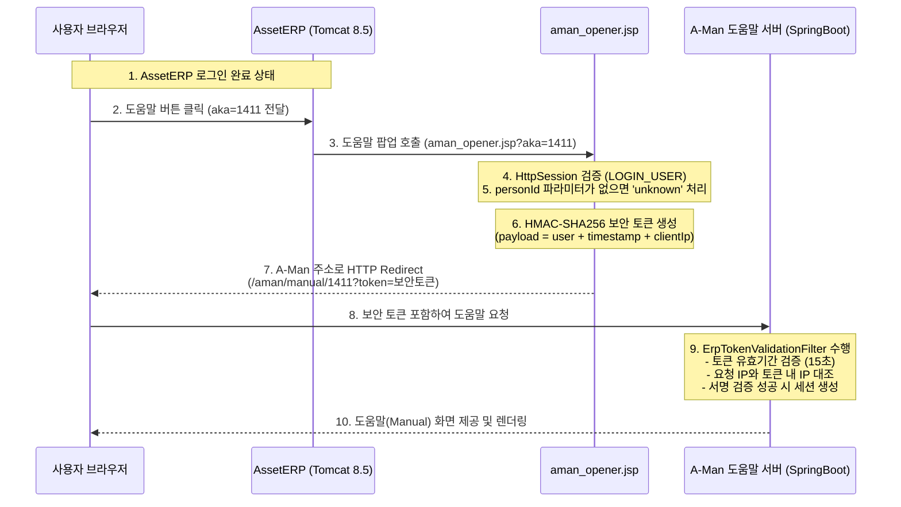

# AssetERP - A-Man 보안 기능 및 연동 현황 보고서

본 문서는 A-Man 도움말 시스템의 중요 정보 자산 유출 방지 및 외부 비인가 접근 차단을 위해 구축된 **네트워크 보안(SSO 토큰 연동)** 및 **화면 보안(브라우저 제어)** 기능의 아키텍처와 구현 내용, 테스트 검증 결과를 정리한 보고서입니다.

---

## 1. 개요 및 설계 원칙

본 프로젝트의 보안 모델은 **"무손상 최소 연동(Zero-Compile)"**과 **"다층 방어 체계(Multi-layered Defense)"**를 지향합니다.

*   **Zero-Compile (무컴파일) 연동**: AssetERP 시스템의 대규모 재컴파일 및 재배포 공수 없이, Tomcat WAS 상에서 즉시 동적 컴파일되는 단일 JSP 게이트웨이(`aman_opener.jsp`)를 통해 연동을 구현했습니다.
*   **세션 격리 및 전달**: 물리적으로 분리된 두 웹 서버(AssetERP와 A-Man) 간의 세션 쿠키 미공유 문제를 해결하기 위해, 검증된 사용자 정보와 IP 주소를 결합한 단기 만료 보안 토큰을 이용하여 안전하게 권한을 이양합니다.
*   **콘텐츠 유출 방지**: 화면 단에서의 손쉬운 마우스/키보드 복사 행위 및 인쇄를 통한 PDF 유출을 차단하여 정보 수집 장벽을 높입니다.

---

## 2. 네트워크 보안 및 SSO 연동 규격

### 2.1 연동 흐름도 (SSO Handshake)



### 2.2 AssetERP 게이트웨이: `aman_opener.jsp`
AssetERP의 Tomcat 컨텍스트 루트 경로(예: `/webapps/ROOT/`)에 배치되어 사용자의 로그인 세션을 직접 검증하고 보안 토큰을 발행합니다.

*   **배치 위치**: AssetERP Context 내부 (세션 공유 목적)
*   **토큰 생성 사양**:
    *   **알고리즘**: `HMAC-SHA256` 대칭키 서명
    *   **페이로드**: `userId(personId) | timestamp | clientIp`
    *   **식별자(personId) 예외 처리**: AssetERP 측 운영 환경에서는 `personId`를 사용하지 않고 **`aka`** 인자만을 전달하며, 이에 따라 `personId`가 전달되지 않을 경우 `userId`는 **`unknown`**으로 자동 할당됩니다.
    *   **보안 서명(Signature)**: 미리 정해진 `SecretKey`와 페이로드를 조립해 암호 서명을 생성한 뒤, 전체 토큰을 URL-Safe Base64 방식으로 인코딩합니다.

### 2.3 A-Man 백엔드 검증 필터: `ErpTokenValidationFilter.java`
Spring Security 필터 체인에서 JWT 필터 뒤에 연결되어 작동합니다.

1.  **세션 및 화이트리스트 검사**:
    *   이미 A-Man 로컬 세션(`AMAN_ERP_AUTHENTICATED=true`)이 존재할 경우 검증을 패스합니다.
    *   사내망 IP 대역 프리패스 기능이 활성화(`aman.security.internal-ip.enabled=true`)되어 있고, 접속자 IP가 허용 대역 목록(`internalIps`)에 포함되는 경우 토큰 없이도 접속이 허용됩니다. (단, 조회만 가능하며 문서 편집은 어드민 로그인을 거쳐야 함)
2.  **보안 토큰 디코딩 및 검증**:
    *   **15초 시간 만료**: 토큰 생성 시간(timestamp)과 서버 현재 시간 차이가 **15초**를 초과하면 위조 또는 탈취된 토큰으로 보고 접근을 불허합니다. (서버 간 시간차 오차 감안 1분 미래 시간 허용)
    *   **IP 일치 검사**: 토큰을 생성했던 당시의 클라이언트 IP(`ipInToken`)와 현재 A-Man에 접근한 클라이언트 IP(`clientIp`)를 일대일 비교하여 불일치 시 차단합니다.
    *   **HMAC 서명 일치 검사**: 동일한 대칭키로 재생성한 서명 값과 토큰의 서명 값이 일치하는지 최종 확인합니다.
3.  **인증 실패 시 리다이렉트**:
    *   비인가 접근 시 일반 로그인 창 대신 세션 만료 경고 페이지인 **`/aman/expired`**로 리다이렉트하여 보안성을 한층 강화하였습니다.

### 2.4 DB 및 GWT 클라이언트 연동 설정

1.  **메뉴 테이블(`sys06_menu`) 연동 URL 설정**
    GWT 클라이언트가 화면별 도움말 주소를 DB에서 참조하여 로드하므로 아래 SQL을 적용하여 새 게이트웨이 주소로 연동합니다.
    ```sql
    -- 예시: 자산등록 화면(Ast01_AssetRegister)의 도움말 링크 업데이트
    UPDATE sys06_menu 
       SET sys06_menual_url = 'aman_opener.jsp?aka=asset_register'
     WHERE sys06_class_nm = 'Ast01_AssetRegister';
    ```

2.  **GWT 클라이언트(`MainFrame.java` L294 부근) 패치**
    도움말 호출 시 로그인한 사용자의 사번을 파라미터로 결합하여 팝업창을 호출합니다.
    ```java
    String setting = "width=1200,height=800,menubars=0,toolbars=0,location=0,scrollbars=yes";

    String menualUrl2 = menualUrl;
    if (menualUrl2 != null) {
        // 이미 ?가 있으면 &로 결합, 없으면 ?로 결합
        String separator = menualUrl2.contains("?") ? "&" : "?";
        menualUrl2 = menualUrl2 + separator + "personId=" + LoginUser.getUserId();

        Window.open(menualUrl2, "help menual", setting);
    }
    ```
    *(※ 운영 시 personId를 누락시키거나 aka만 단독 사용할 경우, aman_opener.jsp에 의해 user 필드는 'unknown'으로 바인딩되어 동작합니다.)*

---

## 3. 브라우저 및 화면 보안 기능

A-Man은 도움말 화면이 브라우저 상에 로드된 이후 발생할 수 있는 정보 탈취 행위를 통제하기 위해 다음 기능을 구현하였습니다.

### 3.1 1단계: 브라우저 기본 제약 설정
마우스와 키보드를 통한 직접적인 텍스트 긁어가기 기능을 원천 차단합니다.
*   **우클릭 방지**: `contextmenu` 이벤트를 가로채 차단하여 브라우저 기본 컨텍스트 메뉴(소스 보기, 다른 이름으로 저장 등)가 나타나지 않습니다.
*   **텍스트 드래그 및 복사 차단**: 
    *   CSS에 `user-select: none` 속성을 적용하여 텍스트가 블록 지정되지 않도록 처리합니다.
    *   JavaScript `selectstart` 및 `copy` 이벤트를 취소하여 무단 복사를 거부하고 경고 알럿을 표시합니다.
*   **핵심 단축키 차단**: F12, Ctrl+Shift+I/C/J(개발자 도구), Ctrl+S(페이지 저장), Ctrl+U(소스 보기) 등을 차단합니다.

### 3.2 2단계: 인쇄(Print) 무력화
사용자가 브라우저 인쇄 기능을 활용해 전체 문서를 PDF 파일로 로컬 저장하는 시도를 무력화합니다.
*   **CSS `@media print` 무력화**: 인쇄 렌더링 시점에 body 및 매뉴얼 영역 전체의 스타일을 `display: none !important;`로 설정하여 인쇄 창 진입 시 **빈 화면(백지)**으로 강제 출력됩니다.

### 3.3 3단계: 무상태(Stateless) 핸드쉐이크 암호화 키 유도 (도입 권장)
API 스크래핑을 통한 대량 매뉴얼 수집(Python 크롤러 등)을 물리적으로 통제하기 위한 기법입니다.
*   **핵심 원리**: 
    `임시 키 = SHA-256( 서버고유Salt + 요청자 IP + 10분 단위 시간 블록 )`
*   **동작 방식**: 
    1. 프론트엔드가 `/api/security/handshake` 호출 시 서버는 요청자 IP 및 시간 블록을 기반으로 생성된 임시 암호화 키를 응답합니다.
    2. 프론트엔드가 매뉴얼 조회 시 서버는 동일 규칙으로 암호화하여 암호문만 전송하며, 프론트엔드는 획득한 키로 즉석에서 복호화해 렌더링합니다.
    3. 이로 인해 세션이나 DB 공간을 낭비하지 않는 오버헤드 0% 환경에서 IP 불일치 및 10분 초과 시 복호화가 실패하여 크롤링이 차단됩니다.

---

## 4. 테스트 및 검증 현황

### 4.1 Mock ERP 테스트 환경 구성
실제 자산운용사의 AssetERP 환경을 에뮬레이션하기 위해 로컬 Tomcat 상에 가상 ERP 웹사이트를 구성하여 연동 테스트를 수행했습니다.

*   **Mock ERP Tomcat 배치 경로**: `/home/kdy987/tomcat/apache-tomcat-8.5.100/webapps/aman-mock`
*   **Vite 개발 주소**: `http://localhost:5173/aman`
*   **ERP 테스트 콘솔 주소**: `http://localhost:8080/aman-mock/index.html`
*   **형상 관리 소스 경로**: `mock-erp/` (내부 구성: `aman_opener.jsp`, `index.html`, `help_popup.html`)

#### 🚨 테스트 환경 내 확인된 참조 버그
*   **이슈 내용**: 현재 `mock-erp/index.html` 내 336라인의 `generateTokenUrl()` 비동기 토큰 계산 함수에서 실제 연동 대상인 `aman_opener.jsp` 대신 레거시 파일명인 `user_manual.jsp`를 비동기 호출하는 참조 오류가 존재합니다.
*   **해결 방안**: 대시보드 테스트 및 정상 동작을 위해 `mock-erp/index.html` 소스 상의 호출 대상 파일명을 `user_manual.jsp`에서 `aman_opener.jsp`로 정정하여야 비동기 토큰 URL 생성 기능이 올바르게 작동합니다. (단, 팝업 기능인 `openHelpPopup()`을 통한 연동 테스트는 이미 `aman_opener.jsp`로 연동되어 정상 작동합니다.)

### 4.2 보안 기능 검증 시나리오 결과

| 검증 시나리오 | 테스트 방법 | 기대 결과 | 검증 여부 |
| :--- | :--- | :--- | :---: |
| **1. 정상 SSO 진입** | 로그인된 ERP 대시보드에서 도움말 팝업 클릭 | A-Man 도움말 화면이 정상 로드됨 | **Pass (성공)** |
| **2. 직접 접근 차단** | 로그인 없이 `/aman/docs` 또는 `/manual/1318` 주소로 직접 브라우저 진입 | `/aman/expired` 오류 화면으로 자동 리다이렉트 및 403 차단 | **Pass (성공)** |
| **3. 토큰 15초 만료** | 생성된 토큰 URL을 확보한 후 **15초 대기**하고 진입 시도 | "유효하지 않거나 만료된 보안 토큰" 오류 창 발생하며 접근 제한 | **Pass (성공)** |
| **4. 기기 IP 불일치 차단** | 15초 이내에 다른 PC 혹은 모바일 브라우저를 통해 생성된 토큰 URL로 접속 시도 | IP 대조 실패로 인해 접근 권한 없음(403) 통제 확인 | **Pass (성공)** |
| **5. 마우스/단축키 차단** | 도움말 화면 내 우클릭, 드래그, F12 단축키 조작 시도 | 이벤트 무반응 및 보안 경고 모달 발생 | **Pass (성공)** |
| **6. 인쇄 미리보기 백지화** | 도움말 화면에서 Ctrl + P 입력 | 인쇄 미리보기 레이아웃 전체가 흰 공백으로 출력 | **Pass (성공)** |

### 4.3 [테스트 #1] 통합 세션 수립 및 폐기 시나리오
A-Man 도움말 시스템의 실시간 세션 통제 수명주기(Lifecycle)가 정상적으로 작동하는지 통합 검증하기 위해 다음과 같이 8단계 테스트 시나리오를 구성하여 테스트하였습니다.

#### 1) 검증 절차 및 결과

| 단계 | 테스트 액션 (사용자 시도) | 기대 결과 및 실제 결과 (동작 검증) | 판정 |
| :--- | :--- | :--- | :---: |
| **1** | `http://localhost:5173/aman/manual/1318` 접속 시도 | A-Man 세션과 토큰이 모두 없는 상태이므로 **접속 차단** | **Pass** |
| **2** | `http://localhost:5173/aman/docs` 접속 시도 | 1단계와 동일하게 비인가 상태로 판명되어 **접속 차단** | **Pass** |
| **3** | `http://localhost:8080/aman-mock/` 접속 후 `[📚 도움말 열기 (Popup)]` 클릭 | `aman_opener.jsp`에서 유효한 일회성 보안 토큰을 생성하여 A-Man으로 성공적 리다이렉트 | **Pass** |
| **4** | `http://localhost:5173/aman/manual/1318` 접속 시도 | 3단계에서 토큰 검증 성공 후 생성된 A-Man 로컬 세션(`AMAN_ERP_AUTHENTICATED`)이 유지되므로 **정상 접속됨** | **Pass** |
| **5** | `http://localhost:5173/aman/docs` 접속 시도 | 4단계와 마찬가지로 활성화된 로컬 세션을 활용하여 **정상 접속됨** | **Pass** |
| **6** | `http://localhost:8080/aman-mock/` 에서 `[🔒 AssetERP 로그아웃]` 클릭 | A-Man 서버 세션 무효화 API(`/docs/security/logout`)를 호출하여 A-Man **로컬 세션 파기 완료** | **Pass** |
| **7** | `http://localhost:5173/aman/manual/1318` 접속 시도 | 로컬 세션이 성공적으로 소멸하였으므로 다시 인가 오류로 판정되어 **접속 차단** | **Pass** |
| **8** | `http://localhost:5173/aman/docs` 접속 시도 | 7단계와 마찬가지로 다시 비인가 상태로 복귀되어 **접속 차단** | **Pass** |

#### 2) 기술적 동작 원리 및 해석
*   **세션 수립**: 사용자가 정상 경로(Mock ERP 팝업)를 통해 A-Man으로 진입하면 일회성 토큰을 소모하며 A-Man 전용 메모리에 인증 상태가 저장되어, 이후 매뉴얼 탐색 시 추가 토큰 없이도 접속이 유지됩니다.
*   **세션 폐기**: ERP에서 로그아웃을 감지하거나 사용자가 수동으로 세션을 소멸시키는 액션을 취하면 A-Man의 내부 `HttpSession`이 무효화되어 다시 모든 접근이 완전히 차단됩니다. 이는 외부 공격자가 최초 발급되었던 URL이나 임시 토큰 정보를 탈취하여 차후에 직접 접속을 시도하는 보안 취약점을 완벽히 극복하는 안전 장치입니다.

### 4.4 [테스트 #2] 어드민 로그아웃 세션 무효화 및 유출 차단 시나리오
어드민 로그인을 통해 접근 권한을 획득한 후, 어드민 로그아웃 시 기존에 유지되던 모든 세션(SSO 연동 권한 포함)이 안전하게 즉시 파기되는지 검증하기 위한 4단계 테스트 시나리오입니다.

#### 1) 검증 절차 및 결과

| 단계 | 테스트 액션 (사용자 시도) | 기대 결과 및 실제 결과 (동작 검증) | 판정 |
| :--- | :--- | :--- | :---: |
| **1** | `http://localhost:5173/aman/admin` 접속 후 어드민 **로그인** 수행 | 정상적으로 어드민 인증 세션 수립 및 관리자 대시보드 진입 성공 | **Pass** |
| **2** | `/manual/1261` 및 `/docs` 페이지 개별 탭 접속 | 어드민 로그인 상태(JWT 쿠키/헤더 유효)이므로 **정상 접속됨** | **Pass** |
| **3** | 우상단 어드민 메뉴에서 **[로그아웃]** 클릭 | 어드민 JWT 토큰 삭제/블랙리스트 차단 및 **HttpSession.invalidate()** 처리 완료 | **Pass** |
| **4** | 다시 `/manual/1261` 및 `/docs` 직접 접속 시도 | 어드민 세션 및 로컬 SSO 연동 세션 정보가 즉시 완전 소멸되었으므로 **접속 차단** (`/aman/expired`로 이동) | **Pass** |

#### 2) 기술적 개선 내용
*   **어드민 로그아웃 시 세션 전면 파기**: 기존에는 로그아웃 시 쿠키의 access_token 삭제 및 블랙리스트 등록만 수행하여 WAS(Tomcat)의 `HttpSession`은 유지되었습니다. 이로 인해 세션에 남아있던 SSO 연동 정보(`AMAN_ERP_AUTHENTICATED`)가 만료되지 않고 접근이 허용되던 문제가 있었으나, 로그아웃 API에 `session.invalidate()` 코드를 강제 호출함으로써 모든 세션 자원을 한 번에 청소하도록 보완했습니다.
*   **Authorization 헤더 블랙리스트 추적 Fallback 구현**: 쿠키가 없는 환경(크로스 도메인 및 포트 CORS 환경)에서 어드민이 헤더를 이용해 로그아웃할 때도 블랙리스트에 정상 차단 등록이 누락되지 않도록 헤더 파싱 로직을 Fallback으로 추가하였습니다.

---


## 5. 실제 운영 서버 반영 가이드

테스트를 정상적으로 마치고 운영 서버에 최종 반영할 시, 아래의 단계별 절차를 준수하여 주십시오.

1.  **A-Man 백엔드 war 빌드 및 배포**
    *   백엔드 프로젝트를 `aman.war`로 빌드하여 운영 서버 Tomcat 8.5 `webapps`에 배포합니다.
2.  **연동 게이트웨이 파일 복사**
    *   [aman_opener.jsp](file:///home/kdy987/work/aman/docs/배포자료/aman_opener.jsp)를 **AssetERP의 톰캣 webapps 루트 경로**에 업로드합니다.
3.  **DB 테이블 메뉴 URL 업데이트**
    *   [update_menu_url.sql](file:///home/kdy987/work/aman/docs/배포자료/update_menu_url.sql) 스크립트를 운영 DB에 반영하여 각 도움말 아이콘이 `aman_opener.jsp?aka=코드`를 호출하도록 설정합니다.
4.  **GWT 클라이언트 코드 배포**
    *   `MainFrame.java`의 L294 부근 팝업 호출 시 user ID 파라미터가 유입되도록 적용한 코드를 빌드 후 운영 서버에 최종 릴리즈합니다.
5.  **보안 속성 값 확인 (`application.properties`)**
    *   운영 환경의 IP 접근 허용 제어를 위해 `aman.security.internal-ip.enabled` 값 및 `internal-ips` 대역 정보가 실서버 공인 IP 또는 사내 대역과 일치하는지 다시 한 번 체크합니다.

## 테스트 시나리오

### 테스트 #1
1. http://localhost:5173/aman/manual/1318 접속 -> 차단됨
2. http://localhost:5173/aman/docs -> 차단됨
3. http://localhost:8080/aman-mock/ 에 접속 '도움말열기' 버튼 클릭
4. http://localhost:5173/aman/manual/1318 접속 -> 접속됨
5. http://localhost:5173/aman/docs -> 접속됨
6. http://localhost:8080/aman-mock/ 에 접속 'AssetERP로그아웃(임시 세션 만료)' 버튼 클릭
7. http://localhost:5173/aman/manual/1318 접속 -> 차단됨
8. http://localhost:5173/aman/docs -> 차단됨

### 테스트 #2
1. http://localhost:5173/aman/admin 으로 접속 로그인
2. http://localhost:5173/aman/manual/1261, http://localhost:5173/aman/docs 접속 됨
3. 로그아웃을 수행함.
4. http://localhost:5173/aman/manual/1261, http://localhost:5173/aman/docs 접속 안됨