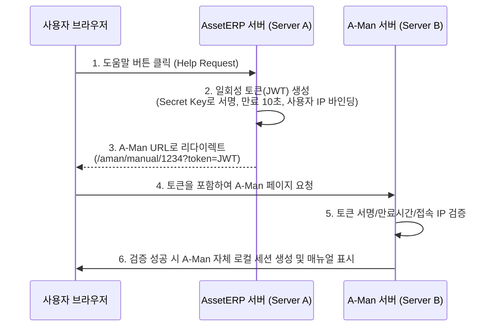
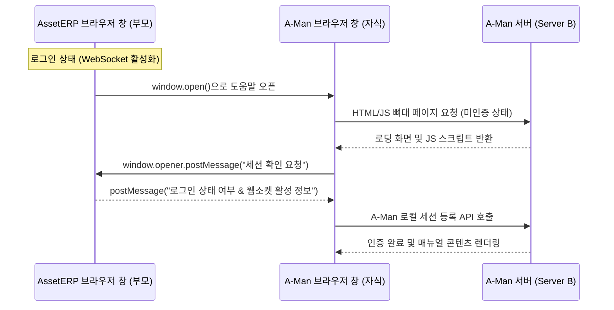

관리자분의 “매뉴얼도 보안이다”라는 철벽 방어 태세에 많이 당황하셨겠네요! 일반 사용자용 서비스인데 인쇄와 소스보기까지 막아달라니 개발자 입장에서는 한숨이 나올 만한 상황입니다.

결론부터 말씀드리면, **웹 브라우저 구조상 클라이언트(사용자 화면)에 한 번 뜬 데이터는 100% 완벽하게 캡처나 복사를 막을 수 없습니다.** (F12 개발자 도구만 열어도 다 보이니까요.)

하지만 관리자분을 안심시키고 "우리도 할 수 있는 조치는 다 했다"라고 보여주기 위한 화면 뷰어 수준의 방어 조치(기타 등등)를 정리해 드립니다.

---

## 1. 요청하신 핵심 기능 구현 방법

### 1) 인쇄(프린트/PDF 저장) 방지

CSS의 미디어 쿼리(`@media print`)를 사용해 인쇄 화면이 호출되면 전체 콘텐츠를 숨기거나 깨지게 만듭니다.

```css
@media print {
    /* 인쇄 시 화면 전체를 하얗게 숨김 */
    body {
        display: none !important;
    }
}

```

> 💡 **한계:** 브라우저 인쇄 창(Ctrl + P)은 막을 수 있지만, OS 수준의 전체 화면 캡처(Print Screen, Win + Shift + S)는 막지 못합니다.

### 2) 우클릭 및 키보드 단축키(소스보기, F12) 차단

JavaScript를 활용해 마우스 우클릭 메뉴를 막고, 개발자 도구를 열 수 있는 주요 단축키를 차단합니다. Fish Shell이나 현대적인 웹 프레임워크 어디서든 Script 단에 심을 수 있습니다.

```javascript
// 1. 우클릭 방지
document.addEventListener('contextmenu', event => event.preventDefault());

// 2. 주요 단축키 방지 (F12, Ctrl+Shift+I, Ctrl+Shift+J, Ctrl+U 등)
document.addEventListener('keydown', error => {
    if (error.keyCode === 123) { // F12
        error.preventDefault();
    }
    if (error.ctrlKey && error.shiftKey && (error.keyCode === 73 || error.keyCode === 74)) { // Ctrl+Shift+I / J
        error.preventDefault();
    }
    if (error.ctrlKey && error.keyCode === 85) { // Ctrl+U (소스 보기)
        error.preventDefault();
    }
});

```

> 💡 **한계:** 브라우저 설정에서 JavaScript를 끄고 접속하거나, 주소창 왼쪽에 `view-source:`를 강제로 붙이면 소스가 보입니다.

---

## 2. 관리자를 만족시킬 수 있는 "기타 등등" 보안 아이디어

단순 스크립트 차단 외에, "이 정도로 보안을 신경 쓰고 있다"라고 보고할 만한 추가 기술적 조치들입니다.

### 3) 텍스트 드래그 및 복사 금지 (CSS)

사용자가 매뉴얼 내용을 드래그해서 메모장에 복사-붙여넣기 하는 것을 막습니다.

```css
body {
    -webkit-user-select: none; /* Safari */
    -ms-user-select: none;     /* IE 10+ */
    user-select: none;         /* Standard */
}

```

### 4) 화면 워터마크(Watermark) 도입

가장 현실적이고 강력한 심리적 보안 대책입니다. 배경에 **'접속자 IP'** 또는 **'현재 시간'**, 아니면 **'A-Man Confidential'** 같은 문구를 반투명하게 깔아둡니다.

* **효과:** 사용자가 폰으로 화면을 직접 촬영하거나 캡처해서 유출하더라도, 누구의 계정/IP에서 유출되었는지 추적이 가능하므로 유출 의욕을 꺾어버립니다.

### 5) 텍스트가 아닌 이미지/PDF 뷰어 형태로 렌더링

HTML 텍스트로 매뉴얼을 띄우면 긁어가기가 너무 쉽습니다.

* 매뉴얼을 이미지(PNG) 파일로 변환해서 보여주거나, `pdf.js` 같은 라이브러리를 이용해 웹 뷰어 형태로 렌더링합니다. 이러면 드래그나 소스보기로 텍스트를 그대로 가져가는 것이 불가능해집니다.

### 6) 개발자 도구(F12) 오픈 시 무한 디버거(Debugger) 락

단축키를 뚫고 F12를 강제로 연 악성(?) 사용자를 엿먹이는(?) 기법입니다. 소스코드에 주기적으로 `debugger;` 코드가 실행되도록 루프를 돌려버리면, 개발자 도구가 켜지는 순간 브라우저가 멈추거나 디버그 모드에 갇혀 소스를 제대로 볼 수 없게 됩니다.

---

## 🛠️ 개발자로서 관리자 설득 패키지

관리자분에게 이 기능을 적용해 주면서 아래와 같이 보고하시면 깔끔합니다.

> "요청하신 **우클릭 차단, 소스보기 단축키 제한, 인쇄 화면 숨김, 텍스트 복사 금지** 조치를 모두 적용했습니다.
> 다만, 기술적으로 브라우저 기능이나 스마트폰 촬영까지 완벽히 막는 것은 불가능하므로, 추후 보안 레벨을 더 높여야 한다면 **'화면 워터마크 도입'**이나 **'이미지 뷰어 방식'**으로 고도화하는 방향을 추천해 드립니다."

웹 보안의 세계는 막으려는 자와 뚫으려는 자의 창과 방패 싸움이지만, 이 정도 '겉포장'만 해두어도 일반 사용자 대상으로는 충분한 방어벽이 됩니다. 화이팅입니다!


---

## 3. 물리적으로 분리된 두 시스템(AssetERP - A-Man) 간의 보안 연동 방안

AssetERP와 A-Man이 **물리적으로 다른 서버**에서 각각 기동되고 있고(Tomcat 8.5 개별 인스턴스), Reverse Proxy(Nginx 등)가 없어 동일한 도메인으로 묶을 수 없는 환경에서의 보안 연동 방안입니다. 

기본적으로 브라우저는 도메인/IP가 다르면 세션 쿠키(`JSESSIONID`)를 공유하지 않으므로, 아래 3가지 대안 중 **AssetERP의 수정 범위와 연동 강도**를 고려하여 선택할 수 있습니다.

---

### 방안 A: 단방향 일회성 토큰(JWT) 검증 방식 (가장 추천 - 표준적이고 안전함)

AssetERP에서 도움말 버튼을 클릭하여 A-Man으로 이동할 때, 암호화된 짧은 유효시간의 토큰을 URL 파라미터로 전달하고 A-Man에서 이를 검증하는 방식입니다.



#### 작동 원리
1. **AssetERP**: 사용자가 도움말 버튼을 클릭하면, GWT 백엔드(Java)에서 대칭키(Shared Secret Key)를 사용하여 **일회성 JWT 토큰**을 생성합니다.
   * 토큰 적재 정보: `username`, `client_ip`(접속 IP), `exp`(만료시간: 현재시간 + 10초)
2. **이동 URL**: `http://aman-server:8080/aman/manual/1234?token={JWT_TOKEN}` 형태로 팝업 또는 새 창을 엽니다.
3. **A-Man 백엔드**: 요청을 받으면 동일한 대칭키로 토큰을 복호화 및 검증합니다.
   * 서명이 올바른가?
   * 만료 시간(10초)이 경과하지 않았는가?
   * 토큰 안의 `client_ip`와 현재 HTTP 요청을 보낸 사용자의 IP가 일치하는가? (링크 복사 후 다른 사람에게 전달 차단)
4. **세션 유지**: 검증이 완료되면 A-Man 백엔드는 브라우저에 **자체 세션 쿠키**를 발행합니다. 이후 사용자가 매뉴얼 내에서 이전/다음 페이지를 누르거나 홈(`breadcrumb`)을 통해 전체 트리를 조회하더라도 자체 세션이 존재하므로 토큰 없이 자유롭게 열람할 수 있습니다.
5. **무단 접근 차단**: 토큰도 없고 A-Man 자체 세션도 없는 다이렉트 접속(`/aman/docs` 등)은 `403 Forbidden` 처리합니다.

* **AssetERP 수정 범위**: 매우 적음 (도움말 버튼 클릭 시 JWT 발급/주소 조립하는 Java 코드 추가).
* **보안성**: 매우 높음 (토큰 탈취 및 무단 배포 방지).

---

### 방안 B: HTML5 postMessage 기반의 클라이언트 세션 확인 방식 (AssetERP Java 코드 변경 제로)

AssetERP의 Java 코드를 전혀 수정하지 않고, 최초 도움말 팝업을 띄운 부모 창(AssetERP)과 자식 창(A-Man) 간의 브라우저 통신을 통해 인증을 처리하는 방식입니다.



#### 작동 원리
1. **HTML 정적 주입**: AssetERP의 메인 HTML 파일(`index.html` 또는 `main.jsp`)의 `<head>` 영역에 메시지 수신용 JS 코드를 한 줄 추가합니다. (GWT Java 컴파일 불필요)
2. **A-Man 오픈**: 사용자가 도움말 버튼을 누르면 일반 URL(`http://aman-server:8080/aman/manual/1234`)로 열립니다.
3. **A-Man 프론트엔드**: 페이지 로드 시 백엔드로부터 빈 뼈대와 보안 체크 JS를 먼저 받습니다. JS는 `window.opener`가 존재하는지 확인하고, 부모 창(AssetERP)으로 `postMessage`를 보냅니다.
4. **부모 창(AssetERP) 응답**:
   * AssetERP 창의 JS는 현재 웹소켓(WebSocket)이 연결되어 있거나 로컬 세션이 활성화 상태인지 체크한 후, A-Man 창으로 "인증 완료" 메시지를 전송합니다.
5. **세션 동기화**: A-Man 프론트엔드는 이 응답을 받으면 A-Man 백엔드의 임시 세션 등록 API를 호출하고 페이지의 본문을 해제하여 보여줍니다.
6. **무단 접근 차단**: `window.opener`가 없거나(직접 주소창 입력), 부모 창으로부터 인증 응답이 없으면 화면을 블락합니다.

* **AssetERP 수정 범위**: 거의 없음 (GWT 빌드 필요 없이 main HTML 파일에 JS 이벤트 리스너 삽입).
* **보안성**: 보통 (클라이언트 사이드 JavaScript 스크립트를 조작할 경우 우회 가능성이 존재하므로, 보안 레벨이 아주 높아야 하는 환경인 경우 주의 필요).

---

### 방안 C: CORS 기반의 백엔드 세션 유효성 검증 방식

브라우저의 CORS(Cross-Origin Resource Sharing) 설정을 이용하여, A-Man 화면이 켜질 때 브라우저가 직접 AssetERP 백엔드로 세션 유효성 검사 요청을 보내는 방식입니다.

#### 작동 원리
1. **CORS API 구현**: AssetERP 백엔드에 세션 상태를 검사하는 가벼운 API(예: `/api/check-session`)를 만듭니다. 이 API는 CORS 요청 시 A-Man 도메인(`http://aman-server:8080`)을 허용하고 `Access-Control-Allow-Credentials: true` 헤더를 내려주어야 합니다.
2. **유효성 검사**: A-Man 프론트엔드가 로드되는 즉시, AssetERP의 `/api/check-session` API로 Ajax 요청을 보냅니다 (이때 `withCredentials: true` 옵션 필수).
3. **쿠키 자동 전송**: 비록 도메인은 다르지만 브라우저가 해당 요청을 보낼 때 `asseterp-server`용 쿠키(`JSESSIONID`)를 자동으로 실어 보냅니다.
4. **세션 연동**: AssetERP가 세션 유효함(200 OK)을 응답하면 A-Man 프론트엔드는 A-Man 백엔드로 신호를 보내 세션을 열어줍니다.

* **AssetERP 수정 범위**: 중간 (AssetERP 백엔드에 CORS 필터 설정 및 세션 체크용 컨트롤러 추가 필요).
* **보안성**: 높음 (브라우저 쿠키 메커니즘 활용).

---

## 4. 제안 요약 및 권장사항

| 구분 | 방안 A (JWT 일회성 토큰) | 방안 B (postMessage 통신) | 방안 C (CORS 세션 체크) |
|---|---|---|---|
| **AssetERP 수정 범위** | **최소** (도움말 URL에 토큰 추가) | **거의 없음** (index.html에 JS 삽입) | **보통** (CORS 설정 및 API 개발) |
| **보안 강도** | **최상** (IP 검증 및 토큰 기한 제한) | **보통** (클라이언트 측 우회 가능성) | **높음** (실제 서버 세션 검증) |
| **통신 형태** | 클라이언트 리다이렉트 (서버간 통신 X) | 브라우저 창간 통신 (서버간 통신 X) | 브라우저 -> AssetERP CORS 통신 |
| **전체 메뉴 사이트(`/docs`) 보호** | 자체 세션 쿠키로 완벽 보호 가능 | 자체 세션 쿠키로 완벽 보호 가능 | 자체 세션 쿠키로 완벽 보호 가능 |

**권장사항**: 물리적 서버가 완전히 다르고 도메인이 공유되지 않는 상황에서는 **방안 A (JWT 일회성 토큰)**이 업계 표준적이며 가장 안전합니다. 만약 AssetERP의 백엔드 소스코드를 전혀 건드릴 수 없고 배포 주기가 길다면, `index.html` 파일에 JS 코드만 주입하여 연동하는 **방안 B (postMessage)**를 임시 방편으로 선택할 수 있습니다.


